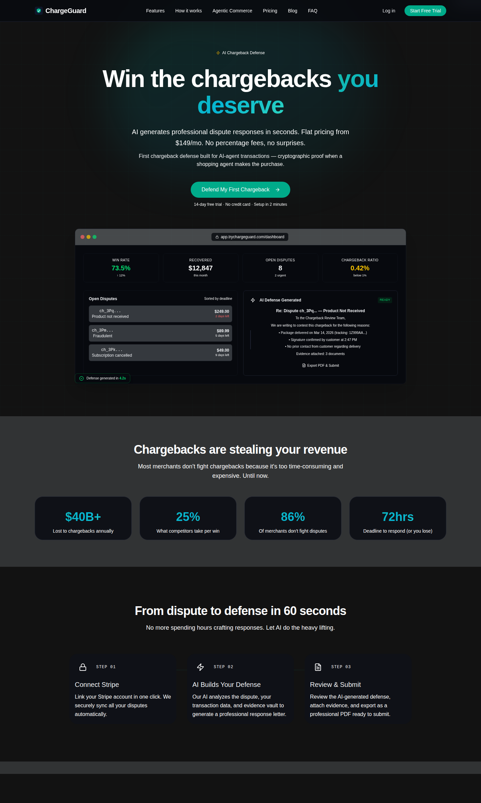
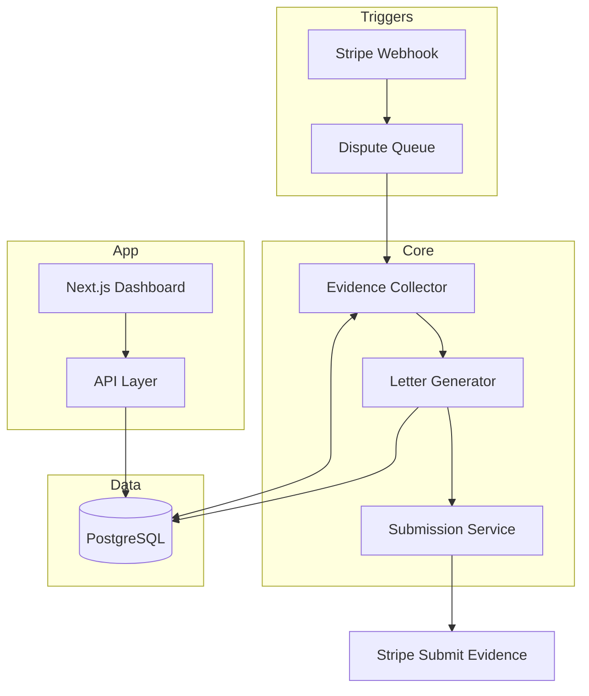

# ChargeGuard

AI-powered chargeback defense for merchants. Auto-generates dispute response letters, manages evidence, and integrates with your payment processor.

Live: [trychargeguard.com](https://trychargeguard.com)

## The problem

Chargebacks cost merchants $25-100 per dispute in lost revenue and fees, and most merchants respond with weak templated letters or don't respond at all. The dispute process is slow, evidence gathering is manual, and win rates hover around 20-30% for unprepared merchants.

Agentic commerce makes this worse: automated purchasing means automated disputes, at machine speed. Merchants need a defense side that runs just as fast.

## What it does

- Dispute intake via payment processor webhook (Stripe)
- Evidence collection: order data, customer history, delivery confirmation, communication logs
- Letter generation: context-aware dispute responses tailored to reason code
- Dashboard: win rate tracking, fraud analysis, monthly trends, reason code breakdown
- Product analytics: PostHog instrumentation

## Architecture

## Stack

| Layer | Tech |
|---|---|
| Frontend | Next.js, Tailwind CSS 4, HeroUI, Radix UI |
| Backend | Node.js, Stripe SDK |
| Database | PostgreSQL |
| Analytics | PostHog |
| Deploy | Vercel |

## What I built

The full product: webhook intake, evidence pipeline, letter generation, the merchant dashboard, and the PostHog instrumentation. Solo project, shipped and live.

## Status

In production at trychargeguard.com. Seeking design partners; pricing is revenue-share on recovered amounts.

---

*This is a showcase repo: architecture and results only, no application source.*
